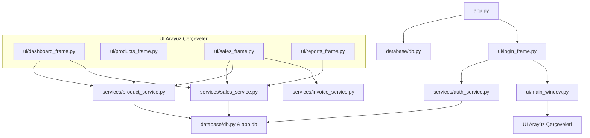

# Stockify - Kod Tabanı Analizi ve Mimari İnceleme

Stockify, Python kullanılarak geliştirilmiş masaüstü tabanlı bir envanter ve satış yönetimi uygulamasıdır. Görsel arayüz için modern `ttkbootstrap` stil çerçevesini, grafik çizimleri için matplotlib kütüphanesini ve yerel veri depolama için hafif SQLite veri tabanını kullanır.

---

## 🏛️ Proje Mimari Genel Bakışı

Proje kod yapısı, kullanıcı arayüzü kontrollerini, iş mantığı servislerini ve veri tabanı yardımcı programlarını birbirinden ayıran temiz bir **Katmanlı Mimari (UI ➔ Servis ➔ Veri Tabanı)** düzenine sahiptir:

---

## 🗄️ Veri Tabanı Tasarımı

Veri tabanı katmanı, `database/db.py` aracılığıyla ve `database/schema.sql` şeması kullanılarak yönetilen bir SQLite (`database/app.db`) dosyasından oluşur.

### 1. Ürünler Tablosu (`products`)
Alış fiyatı, satış fiyatı ve stok seviyelerini barındıran envanter ögelerini depolar.
* `id` (INTEGER PRIMARY KEY AUTOINCREMENT)
* `name` (TEXT, NOT NULL) - Ürün Adı
* `category` (TEXT) - Kategori
* `stock_quantity` (INTEGER, DEFAULT 0) - Stok Miktarı
* `purchase_price` (REAL, DEFAULT 0) - Alış Fiyatı
* `sale_price` (REAL, DEFAULT 0) - Satış Fiyatı
* `min_stock_level` (INTEGER, DEFAULT 5) - Kritik Minimum Stok Seviyesi
* `created_at` (TEXT) - Oluşturulma Tarihi
* `updated_at` (TEXT) - Güncellenme Tarihi

### 2. Satışlar Tablosu (`sales`)
İşlem geçmişini depolar ve işlem başına elde edilen kârı hesaplar.
* `id` (INTEGER PRIMARY KEY AUTOINCREMENT)
* `product_id` (INTEGER, NOT NULL) - `products(id)` tablosuna Foreign Key ile bağlıdır (ON DELETE CASCADE)
* `quantity` (INTEGER, NOT NULL) - Satış Adedi
* `unit_price` (REAL, NOT NULL) - Birim Satış Fiyatı
* `total_price` (REAL, NOT NULL) - Toplam Satış Tutarı
* `profit` (REAL, NOT NULL) - Kazanılan Kâr
* `sale_date` (TEXT, NOT NULL) - Satış Tarihi

### 3. Kullanıcılar Tablosu (`users`)
Sisteme erişimi olan kullanıcı hesaplarını ve yetki rollerini tutar. Parolalar SHA-256 algoritmasıyla şifrelenmiştir.
* `id` (INTEGER PRIMARY KEY AUTOINCREMENT)
* `username` (TEXT, UNIQUE, NOT NULL) - Kullanıcı Adı
* `password_hash` (TEXT, NOT NULL) - SHA-256 Şifre Hash Değeri
* `role` (TEXT, NOT NULL) - Rolü (`admin` veya `kasiyer`)

### İndeksler
Arama ve sorgu performanslarını optimize etmek için şu indeksler tanımlanmıştır:
* `idx_products_name` -> `products(name)` üzerinde
* `idx_sales_product_id` -> `sales(product_id)` üzerinde
* `idx_sales_date` -> `sales(sale_date)` üzerinde
* `idx_users_username` -> `users(username)` üzerinde

---

## ⚙️ Arka Plan Servisleri ve İş Mantığı

### `services/auth_service.py` (Yeni)
* `login_user(username, password)`: Girilen şifreyi SHA-256 ile hash'ler ve veri tabanında eşleşen kullanıcıyı arar. Başarılı ise kullanıcı adı ve rolünü döner.

### `services/invoice_service.py` (Yeni)
* `generate_html_invoice(product_name, quantity, unit_price, total_price, cashier_name)`:
  * Satış sonrasında kurumsal tasarımlı bir HTML fatura belgesi oluşturur.
  * Fatura dosyasını `exports/fatura_[id].html` konumuna kaydeder.
  * İşlem bittiğinde faturayı otomatik olarak varsayılan internet tarayıcısında açar. Tarayıcı penceresinden tek tuşla "Yazdır / PDF Olarak Kaydet" yapılmasına olanak tanır.

### `services/product_service.py`
Envanter yönetimi için CRUD işlemlerini sağlar:
* `add_product(...)` ve `update_product(...)`: Ürün verilerini kaydeder veya düzenler.
* `get_all_products()`: Tüm ürünleri azalan ID sırasına göre listeler.
* `search_products(keyword)`: Ürün adı veya kategorisinde arama yapar.
* `delete_product(product_id)`: Belirtilen ürünü veri tabanından siler.

### `services/sales_service.py`
Satış işlemlerini ve analitik veri tahminlemelerini yönetir:
* `create_sale(product_id, quantity)`:
  * Ürünün stok kontrolünü yapar, kârı hesaplar, satış kaydını oluşturur ve envanter stokunu düşer.
* `get_ai_sales_forecast()` (Yeni):
  * **Yapay Zeka Destekli Talep Tahmini:** Her bir ürünün son 10 günlük satış geçmişine dayanarak günlük satış hızını (satış adedi / 10 gün) hesaplar.
  * Gelecek 7 güne ait tahmini satış adedini doğrusal tahminleme modeli kullanarak öngörür.
  * Stoğun kaç gün içinde tükeneceğini (`stock / daily_velocity`) hesaplayarak jürinin seveceği akademik bir tahmin motoru sunar.

---

## 🎨 Kullanıcı Arayüzü (UI) Bileşenleri

Arayüz, modern bir koyu tema olan `"darkly"` ve aydınlık tema olan `"flatly"` kullanılarak geliştirilmiştir:

1. **`LoginFrame` (`ui/login_frame.py`) (Yeni)**
   * Uygulama açılışında gelen, şık ve ortalanmış giriş formudur.
   * `admin` (şifre: `admin123`) ve `kasiyer` (şifre: `kasiyer123`) varsayılan hesapları ile sisteme giriş imkanı tanır.

2. **`MainWindow` (`ui/main_window.py`)**
   * Sol menüde giriş yapan kullanıcının adı ve rolünü (Yönetici/Kasiyer) gösterir.
   * **Rol Tabanlı Yetkilendirme (RBAC):** Eğer giriş yapan kullanıcı rolü `kasiyer` ise, hassas raporlama bilgilerinin olduğu "Raporlar" butonu kısıtlanır (Disabled yapılır).
   * Menünün altındaki buton ile anlık tema geçişi sağlar.

3. **`DashboardFrame` (`ui/dashboard_frame.py`)**
   * İstatistik kartları ve iki adet görsel grafik içerir.
   * **🤖 Yapay Zeka Analiz Paneli:** "Genel Bilgi" kartı yerine entegre edilen bu yeni tabloda, Yapay Zeka tahmin motorundan alınan veriler sergilenir (ürünün haftalık tahmini satışı, stok tükenme gün öngörüsü ve tükenme durum uyarısı).

4. **`ProductsFrame` (`ui/products_frame.py`)**
   * **Kasiyer Kısıtlaması:** Eğer giriş yapan kullanıcı bir Kasiyer ise, ürün ekleme formu ve "Kaydet, Güncelle, Sil" butonları otomatik olarak kilitlenir (kasiyerin envanteri bozması engellenir).

5. **`SalesFrame` (`ui/sales_frame.py`)**
   * Satış kaydetme aracıdır. Satış yapıldığında kullanıcıya fatura oluşturmak isteyip istemediği sorulur ve tek tıkla HTML fatura oluşturulur.
